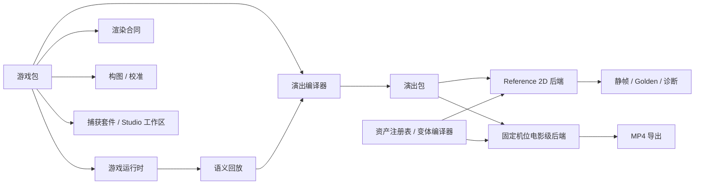

# Melo Game Creative Studio

**面向 IAA 消除类投放素材的浏览器创作、导演与固定机位渲染平台。**

Melo 从可复现的**二维玩法真值**出发，把规则、操作、演出节奏、视觉资产与视频导出拆成独立层，在固定摄像机下完成材质化与特效合成，输出具三维质感的竖屏成片（1080×1920）。

| | |
|---|---|
| **版本** | `0.3.0-alpha.4` |
| **演示游戏** | Block Placement（方块放置）、TapTile Tray Match3（托盘三消）、crash wooooood!（方块撞击） |
| **规划** | Mahjong（麻将，Studio 即将上线；无智能体出题 / 出片适配器） |
| **本版交付** | 原子命令行 + 官方组合技能（Skill）+ 三款游戏的出题 / 换皮 / 试玩 / Chrome 出片 |

> 项目名来自首款 **Block Placement** 原型，但目标是可注册多款 IAA 消除玩法的「游戏市场」：每款游戏自带规则与演出模块，共享资产、导演、渲染、导出与质量基础设施。

---

## 核心命题

```text
二维玩法真值
        ↓
语义回放 / 规则结算
        ↓
导演节奏与演出层
        ↓
固定摄像机下的空间化、材质化与特效
        ↓
确定性逐帧渲染
        ↓
1080×1920 投放视频
```

「二维」指**规则与终局状态**在格阵或分层拓扑中求解，而非成片只能是平面贴图。厚度、物理渲染材质（PBR）、灯光、碎片与粒子属于表现层；Melo 不用三维物理去「猜」玩法结果。

---

## 为什么需要 Melo

传统素材生产常把玩法、镜头、特效与换皮绑在同一工程里：改材质可能破坏动画，改节奏要重录玩法，换游戏要重建工具链。

| 目标 | 做法 |
|---|---|
| **玩法拟真** | 独立**游戏运行时**；人与智能体（Agent）共用语义动作，不靠像素反推 |
| **视觉质量** | **二维参考后端（Reference 2D）**锁布局与时序；**固定机位电影级后端**负责材质、体积与后处理 |
| **高效变体** | 回放、导演、外观造型、材质与输出参数解耦，同盘玩法可换皮重导 |
| **批量生产** | 版本化资产、**变体编译器**、**质量门禁**、稳定哈希、固定帧导出 |

Melo 不是通用引擎、自由摄像机三维编辑器，也不是一次性「提示词出视频」工具。它专注：**玩法可信、画面可审、换皮可复现的消除类投放视频**。

---

## 三层真值

### 玩法真值 — 发生了什么

初始配置、合法动作、提交 / 检测 / 消解 / 重配置 / 落定、实体变更、分数与终局哈希。不依赖 React、Canvas、Three.js 或帧率。

### 演出真值 — 观众如何看见

拾取与落子时长、清除与坍塌节奏、镜头冲击、连击反馈、导演轨迹与**固定帧演出包（Presentation Packet）**。同一回放可换导演节奏而不改规则结果。

### 像素真值 — 像素从哪来

二维精灵与着色器、浅三维网格、PBR、固定机位、阴影与后处理；画布 / WebGL 合成与 WebCodecs 编码。二维参考后端与电影级后端可不同实现，但须共享玩法、回放、事件身份与帧时间。

---

## 多游戏平台架构

每款游戏是独立的**游戏包（Game Package）**，不是平台里的 `if (gameId === …)`。



**平台统一提供：** 注册表与模式（Schema）、工程 / 回放校验、资产 / 外观 / 材质 / 特效包、变体编译器、三种不变量策略、构图与校准、二维参考 / 固定机位 / 捕获 / Golden / WebCodecs 导出、**架构守卫**与持续集成。

**每款游戏单独提供：** 状态 / 动作 / 规则集、玩法拓扑、规则→演出编排、布局与抬头显示、语义资产槽位、Studio 工作区与捕获证据。

---

## 游戏目录

| 游戏 | 玩法真值 | 主要动作 | 消解 / 重配置 | 状态 |
|---|---|---|---|---|
| **Block Placement**（方块放置） | 8×8 格阵 | 三候选块拖拽落子 | 满行满列同步清除 | Studio 完整；CLI 可出题/换皮/试玩/出片；人工审片以本游戏五条片为主 |
| **TapTile Tray Match3**（托盘三消） | 分层叠牌 + 托盘三消 | 点选入托盘 | 三消、解锁、托盘满则败 | Studio 演示；CLI 同上；短预览 ≠ 商业画质 |
| **crash wooooood!**（方块撞击） | 格阵支撑/重力 | 上方落块 | 破坏与坍塌稳定 | Studio 演示；CLI 同上；换皮不改玩法哈希 |
| **Mahjong**（麻将） | 层级 + 阻塞图 | 配对同类牌 | 移除并重算可用集 | Studio 即将上线；`mahjong-solitaire` 不可 `agent run` |

新游戏不必共享同一棋盘，只需遵守统一生产协议。

---

## Studio 与命令行 + 技能：两条入口

系统**不内置大语言模型**；提供稳定、可审计的协议供人与外部智能体调用。自动化分两层：**CLI（原子）**负责单条命令；**Skill（组合）**负责可编辑配方（见 `skills/`）。

| 入口 | 面向 | 能力概要 |
|---|---|---|
| **Studio** | 人类（Chrome） | 方块放置为完整工作台与人工片单；托盘三消 / 方块撞击可演示；麻将即将上线 |
| **CLI + Skill** | 智能体、CI、后端 | 三款游戏共用原子命令；`skills/` 为可改组合配方；有 Chrome 才能真出 MP4 |

**Studio（以方块放置为主）：** 8×8 与候选块编辑、试玩与机器玩家、语义动作与回放、多套导演节奏；二维参考后端锁时序，固定机位电影级后端出厚度 / PBR / 碎片；1080×1920 H.264 导出。审片片单见 [`docs/LOCAL_REVIEW_AND_FEEDBACK.md`](docs/LOCAL_REVIEW_AND_FEEDBACK.md)。

**CLI（三款演示游戏）：** `gameId` 为 `block-placement`、`taptile-tray-match3`、`block-crush-drop`。原子路径：出题 → 换皮 → `agent run` → `take validate` → `document emit` → `render`。`melo produce` 是便捷捷径，不是唯一路径；多皮矩阵请用 Skill，勿扩 CLI 开关。Node **不得**在无编码时写 `rendered: true`；无 Chrome 时 `CHROME_NOT_FOUND` 可恢复。方块放置的 `look.copper` / `look.candy-resin` 写在 `lookPackRef`；`look.copper` 为参数铜金属，非计划绑定的 PBR 贴图。

**资产与变体：** 浏览器 IndexedDB 资产库、SHA-256；创意主档 + 变体配方 → 解析后的渲染计划；质量门禁与计划哈希。CLI 保持原子、Skill 负责编排——索引 [`skills/README.md`](skills/README.md)，命令 [`docs/cli/README.md`](docs/cli/README.md)。

---

## 快速开始

**要求：** Node.js `22.12+`、npm `10+`、近期桌面 Chrome。

### 入口 A：Studio

```bash
git clone https://github.com/dongyuan21/melo-game-creative-studio.git
cd melo-game-creative-studio
npm install
npm run dev
```

打开 `http://127.0.0.1:4173`，可导入 `examples/demo-cross-clear.melo.json`，在导演回放中对比二维参考外观与固定机位造型后导出 MP4。

### 入口 B：CLI + Skill

GitHub Pages 仅前端；CLI 在本机或后端运行。

```bash
npm run build:cli
node dist-cli/cli/melo.js capabilities
```

- 出题到出片配方：[`skills/melo-from-puzzle-to-mp4/SKILL.md`](skills/melo-from-puzzle-to-mp4/SKILL.md)  
- 同一份试玩记录换多套皮：[`skills/melo-remix-looks/SKILL.md`](skills/melo-remix-looks/SKILL.md)

```bash
node dist-cli/cli/melo.js produce \
  --game block-placement \
  --template showcase \
  --skin look.copper \
  --seed 7 \
  --max-moves 8 \
  --out-dir /tmp/placement-produce
node dist-cli/cli/melo.js render \
  --out-dir /tmp/placement-produce \
  --quality preview \
  --max-frames 8
```

`--max-frames` 仅截断预览；勿与 Studio 五条评审片混评。

**变体与门禁示例：**

```bash
node dist-cli/cli/melo.js variant compile \
  --master examples/headless/master.demo.json \
  --recipe examples/headless/variant.copper.demo.json \
  --assets examples/headless/assets \
  --renderer fixed-camera-cinematic \
  --require-hashes \
  --out /tmp/melo-plan.json
node dist-cli/cli/melo.js quality check --plan /tmp/melo-plan.json --strict --require-hashes
```

---

## 校验与构建

```bash
npm run check
npm test
npm run typecheck
npm run build
npm run test:browser-e2e
```

公开固定样例全量捕获：`npm run capture:review`（静帧 + 无声 MP4）。软件 WebGL / 公共样例的通过只表示链路通过，**不等于**商业画质已批准。

---

## 仓库目录

```text
src/
├── game-runtime/     # 多游戏状态 / 动作 / 回放 / 模式
├── games/            # 演示游戏包
├── bootstrap/        # 游戏包组装
├── headless/         # 资产、变体、质量、材质（无头核心）
├── rendering/        # 后端、构图、渲染任务
├── capture/          # Golden 与浏览器捕获
├── studio/           # Studio 外壳
├── cli/              # 机器可读命令行
├── assets/           # 浏览器资产绑定
└── exporter/         # WebCodecs / MP4
skills/               # 官方 Skill：原子命令说明 + 组合配方
packages/dsh-plugin-melo/   # DeepSeek Harness 薄插件（包装 CLI，非第二套引擎）
```

`scripts/check-architecture.mjs` 在 CI 中禁止平台反向依赖游戏包、禁止游戏包互引。

---

## 当前阶段与边界

| 项目 | 状态 |
|---|---|
| 多游戏平台 R0–R8b | 已合入 `main` |
| 三款演示游戏 | Studio 可开；CLI 可出题 / 换皮 / 试玩 / 出片 |
| 原子 CLI + 官方 Skill | 本版已交付；Skill 负责编排，非延后项 |
| 麻将 | Studio 即将上线；CLI 不可调度 |
| 云端托管 CLI | 延后；Pages 仅部署前端 |
| 商业参考 Golden | `BLOCKED`（无私有源片） |
| 人工视觉批准 | `PENDING`（方块放置五条 MP4 片单） |
| 音频 / BGM / 旁白 | 未进入导出链 |
| R9 默认 V2、删除遗留路径 | `DEFERRED` |

当前为架构与生产链 Alpha：测试通过、样例通过或结构契约**不能**等同于最终广告品质。

---

## DeepSeek Harness（dsh）

在 [DeepSeek Harness](https://deepseek-harness.github.io/deepseek-harness/) 中启用 Melo：**薄插件** `@melo-game/dsh-plugin-melo` 只注册 CLI 包装工具与捆绑 Skill，不重写运行时 / Studio / 出片。

```bash
npm run build:cli
export MELO_CLI_PATH="$PWD/dist-cli/cli/melo.js"
dsh plugin --profile web add link:$PWD/packages/dsh-plugin-melo
dsh plugin --profile web add @orderg-x/dsh-video-preview   # 可选：对话内联播放 MP4
```

详见 [`docs/dsh/README.md`](docs/dsh/README.md)。未装 video-preview 时仍会得到 MP4 路径与文件芯片。

---

## 文档导航

| 文档 | 内容 |
|---|---|
| [`docs/dsh/README.md`](docs/dsh/README.md) | dsh 薄插件：宿主 + CLI + Skill |
| [`docs/LOCAL_REVIEW_AND_FEEDBACK.md`](docs/LOCAL_REVIEW_AND_FEEDBACK.md) | 本机审片片单与反馈方式 |
| [`docs/ENGINEERING.md`](docs/ENGINEERING.md) | 能力、命令、二维参考审计 |
| [`docs/ARCHITECTURE.md`](docs/ARCHITECTURE.md) | 真值分层、Reference 2D、数字内容创作工具边界 |
| [`docs/reports/MULTI_GAME_REFACTOR_R0_R8B_DELIVERY.md`](docs/reports/MULTI_GAME_REFACTOR_R0_R8B_DELIVERY.md) | 多游戏重构交付与限制 |
| [`docs/cli/README.md`](docs/cli/README.md) | 无头 CLI 原子命令 |
| [`skills/README.md`](skills/README.md) | Skill 索引 |
| [`skills/melo/SKILL.md`](skills/melo/SKILL.md) | 外部智能体入口 |
| [`docs/architecture/HEADLESS_CORE_V1.md`](docs/architecture/HEADLESS_CORE_V1.md) | 无头核心 |
| [`docs/architecture/ASSET_IMPORT_PIPELINE_V1.md`](docs/architecture/ASSET_IMPORT_PIPELINE_V1.md) | 资产导入编译链路 |

---

## 数字内容创作（DCC）与外部工具

Blender、After Effects 等**不是**玩法真值来源，更适合作为资产工厂：固定视角精灵图 / 翻页序列、网格与材质、预烘焙轨道、可换光中间件，以及带摄像机配置与预算的运行时资产——在保留 DCC 画质的同时避免不可审计的手工工程。

---

## 许可与内容边界

代码：[MIT License](LICENSE)。

仓库为独立实现与公开固定样例，不含第三方品牌、原画、音源或内部算法；商业参考片不入库；视觉结论须保留证据状态，勿将推测写成已验证事实。
