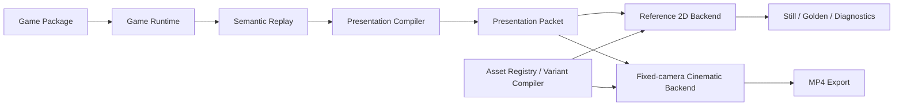

# Melo Game Creative Studio

**从可复现的二维玩法真值出发，在固定机位下做出玩法可信、可换皮、可批量导出的竖屏消除类投放视频（1080×1920）——人类在 Studio 精修导演，智能体用 CLI + Skill 自动出题与出片。**

**在线演示（GitHub Pages，仅前端 Studio）：** [https://dongyuan21.github.io/melo-game-creative-studio/](https://dongyuan21.github.io/melo-game-creative-studio/)  
本地完整能力（含 MP4 导出与 CLI）见下方快速开始；Pages 上不跑 Node CLI。

当前版本 `0.3.0-alpha.4` · 演示游戏：**Block Placement**、**TapTile Tray Match3**、**crash wooooood!** · Mahjong 为 Studio Coming Soon（`gameId`: `mahjong-solitaire`，勿对其跑 `agent run`）

| | |
|---|---|
|  |  |
| 固定机位 Cinematic 后端静帧（仓库内回归样例） | Reference 2D 峰值帧（布局与时序锁定） |

<!-- screenshot: Studio 导演回放与 Reference 2D / 固定机位切换（`npm run dev` → 导入 examples/demo-cross-clear.melo.json） -->
<!-- screenshot: CLI produce + render 产出目录中的 video.mp4 与 render-request.json -->

---

## 你能得到什么

- **玩法先算清，再谈画面**：规则在独立 Game Runtime 里求结果；人与 Agent 共用语义 Action，不靠录屏或像素反推棋盘。
- **同一盘玩法，多套皮、多条片**：Replay、导演节奏、Look 与输出参数解耦；换皮不必重录操作。
- **固定机位出「像广告」的三维质感**：Reference 2D 锁时序，Fixed-camera Cinematic Backend 负责材质、体积与后处理——不是自由摄像机通用引擎。
- **两条入口，职责清晰**：**入口 A：Studio** 给人审片与导出；**入口 B：CLI + Skill** 给 CI 与外部 Agent（GitHub Pages 只部署前端，CLI 在本机或后续后端运行）。
- **可审计的生产链**：**CLI（原子）** 是一条条稳定命令；**Skill（组合）** 是可改官方配方，不把编排硬塞进二进制。

架构分层、多游戏包边界、阶段表与 DCC 约定见 [`docs/ARCHITECTURE.md`](docs/ARCHITECTURE.md)、[`docs/ENGINEERING.md`](docs/ENGINEERING.md)、[`docs/reports/MULTI_GAME_REFACTOR_R0_R8B_DELIVERY.md`](docs/reports/MULTI_GAME_REFACTOR_R0_R8B_DELIVERY.md)。

---

## 快速开始

**环境：** Node.js `22.12+`、npm `10+`、近期桌面版 Chrome（WebCodecs 出 MP4 时需要）。

### 入口 A：Studio

```bash
git clone https://github.com/dongyuan21/melo-game-creative-studio.git
cd melo-game-creative-studio
npm install
npm run dev
```

浏览器打开 `http://127.0.0.1:4173`，导入 `examples/demo-cross-clear.melo.json`，进入**导演回放**，对比 Reference 2D 与固定机位 Cinematic Look 后导出 1080×1920 MP4。

**你应该看到：** 本机 Studio 可编辑 / 试玩 Block Placement，并能导出竖屏视频或静帧。统一审片片单见 [`docs/LOCAL_REVIEW_AND_FEEDBACK.md`](docs/LOCAL_REVIEW_AND_FEEDBACK.md)。

### 入口 B：CLI + Skill

先构建 CLI，再按官方 Skill 编排原子命令（不要把 Skill 当成第二套实现）。

```bash
npm run build:cli
node dist-cli/cli/melo.js capabilities
node dist-cli/cli/melo.js agent list
node dist-cli/cli/melo.js produce \
  --game block-placement \
  --template showcase \
  --skin look.copper \
  --seed 7 \
  --max-moves 8 \
  --out-dir /tmp/melo-preview
node dist-cli/cli/melo.js render \
  --out-dir /tmp/melo-preview \
  --quality preview \
  --max-frames 48
```

从出题到可选出片：[`skills/melo-from-puzzle-to-mp4/SKILL.md`](skills/melo-from-puzzle-to-mp4/SKILL.md)。同一份 Take 换多套皮：[`skills/melo-remix-looks/SKILL.md`](skills/melo-remix-looks/SKILL.md)。命令手册：[`docs/cli/README.md`](docs/cli/README.md)。

**你应该看到：** `capabilities` 返回 JSON；`produce` 写入 `config.json`、`document.json` 等；本机有 Chrome 时 `render` 生成 `video.mp4`，且仅在真编码后 `rendered: true`——无 Chrome 时为可恢复的 `CHROME_NOT_FOUND`。

可调度的 `gameId`：`block-placement`、`taptile-tray-match3`、`block-crush-drop`。

---

## 常见路径

| 想做的事 | 从这里开始 |
|---|---|
| 人类精修、审片、导出 | Studio（入口 A）；Block Placement 最完整 |
| 出题 → 试玩 → 工程 → 出片 | Skill `melo-from-puzzle-to-mp4` 或 `melo produce` |
| 同一份试玩记录换多套皮 | Skill `melo-remix-looks` |
| 查原子命令与 JSON 契约 | [`docs/cli/README.md`](docs/cli/README.md)、[`skills/README.md`](skills/README.md) |
| Reference 审计、校验命令、实现细节 | [`docs/ENGINEERING.md`](docs/ENGINEERING.md) |

---

## 怎么拼在一起



Gameplay Truth → 语义回放 → Presentation → 双后端成片；Studio Shell、Capture Suite 与质量门禁的完整说明见 [`docs/ARCHITECTURE.md`](docs/ARCHITECTURE.md)。

---

## CLI（原子）与 Skill（组合）

Melo 不内嵌 LLM。自动化分两层：

| 层 | 位置 | 职责 | 谁改 |
|---|---|---|---|
| **CLI（原子）** | `node dist-cli/cli/melo.js …` | 出题、换皮、试玩、校验、收工程、出片、资产 / 变体 / 门禁 | 改命令契约才动这里 |
| **Skill（组合）** | `skills/` | 把原子命令排成可编辑配方 | 官方维护默认 Skill；外部 Agent 可复制或另写 |

索引：[`skills/README.md`](skills/README.md)。Agent 入口：[`skills/melo/SKILL.md`](skills/melo/SKILL.md)。

---

## 本地校验

```bash
npm run check
npm test
npm run typecheck
npm run build
```

公开 Fixture 捕获（Still / 无声 MP4，用于回归）：`npm run capture:review`。

---

## 文档导航

| 文档 | 内容 |
|---|---|
| [`docs/LOCAL_REVIEW_AND_FEEDBACK.md`](docs/LOCAL_REVIEW_AND_FEEDBACK.md) | 本机审片片单与可复现视觉反馈 |
| [`docs/ENGINEERING.md`](docs/ENGINEERING.md) | 能力、命令、校验与工程实现 |
| [`docs/ARCHITECTURE.md`](docs/ARCHITECTURE.md) | 真值分层、渲染与 DCC 边界 |
| [`docs/cli/README.md`](docs/cli/README.md) | Headless CLI 原子命令 |
| [`skills/melo/SKILL.md`](skills/melo/SKILL.md) | 外部 Agent 入口 |
| [`docs/architecture/HEADLESS_CORE_V1.md`](docs/architecture/HEADLESS_CORE_V1.md) | Agent-neutral Headless Core |

---

## 许可

代码采用 [MIT License](LICENSE)。本仓库为独立实现与公开样例，不含第三方商业品牌素材；勿将未验证的视觉结论写成已批准事实。
