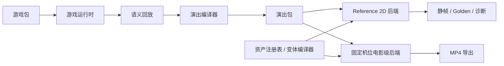

# Melo Game Creative Studio

**在浏览器里做出玩法可信、可换皮、可批量复现的竖屏消除类投放视频（1080×1920）——同一盘玩法，人类在 Studio 精修，智能体用命令行自动出片。**

当前版本 `0.3.0-alpha.4` · 演示游戏：Block Placement（方块放置）、TapTile Tray Match3（托盘三消）、crash wooooood!（方块撞击）

| | |
|---|---|
 |  |
| 固定机位电影级后端静帧（仓库内回归样例） | 二维参考后端峰值帧（布局与时序锁定） |

<!-- screenshot: Studio 导演回放与 Reference 2D / 固定机位切换（`npm run dev` → 导入 examples/demo-cross-clear.melo.json） -->
<!-- screenshot: CLI produce + render 产出目录中的 video.mp4 与 render-request.json -->

---

## 为什么做 Melo

- **玩法先算清，再谈画面**：规则在独立运行时里求结果，人与智能体共用语义动作，不靠录屏或像素反推棋盘。
- **同一盘玩法，多套皮、多条片**：回放、导演节奏、外观与输出参数拆开；换皮不必重录操作。
- **固定机位出「像广告」的三维质感**：二维参考锁时序，电影级后端负责材质、体积与后处理，不是自由摄像机游戏引擎。
- **给 Agent 用的稳定生产线**：**CLI（原子）**是一条条可审计命令；**Skill（组合）**是可改配方，不把编排硬塞进二进制。
- **多游戏一张平台**：每款玩法是独立游戏包，共享资产、变体编译、质量门禁与导出链（细节见 [`docs/ARCHITECTURE.md`](docs/ARCHITECTURE.md)）。

---

## 快速开始

**环境：** Node.js `22.12+`、npm `10+`、近期桌面版 Chrome（出 MP4 时需要）。

### 入口 A：Studio

```bash
git clone https://github.com/dongyuan21/melo-game-creative-studio.git
cd melo-game-creative-studio
npm install
npm run dev
```

浏览器打开 `http://127.0.0.1:4173`，导入 `examples/demo-cross-clear.melo.json`，进入导演回放，对比二维参考与固定机位外观后导出 MP4。

**你应该看到：** 本机 Studio 页面可编辑/试玩方块放置局，并能导出竖屏视频或静帧（具体片单见 [`docs/LOCAL_REVIEW_AND_FEEDBACK.md`](docs/LOCAL_REVIEW_AND_FEEDBACK.md)）。

### 入口 B：CLI + Skill

```bash
npm run build:cli
node dist-cli/cli/melo.js capabilities
node dist-cli/cli/melo.js produce \
  --game block-placement \
  --template showcase \
  --seed 7 \
  --max-moves 8 \
  --out-dir /tmp/melo-preview
node dist-cli/cli/melo.js render \
  --out-dir /tmp/melo-preview \
  --quality preview \
  --max-frames 48
```

配方与多皮编排：[`skills/melo-from-puzzle-to-mp4/SKILL.md`](skills/melo-from-puzzle-to-mp4/SKILL.md)、[`skills/melo-remix-looks/SKILL.md`](skills/melo-remix-looks/SKILL.md)。命令全集：[`docs/cli/README.md`](docs/cli/README.md)。

**你应该看到：** `capabilities` 返回 JSON；`produce` 在输出目录写入 `config.json`、`document.json` 等；有 Chrome 时 `render` 生成 `video.mp4`，且仅在真编码后 `rendered: true`——无 Chrome 时为可恢复的 `CHROME_NOT_FOUND`。

在 [DeepSeek Harness](https://deepseek-harness.github.io/deepseek-harness/) 里可用薄插件一键包装上述 CLI（见 [`docs/dsh/README.md`](docs/dsh/README.md)）。

---

## 你能做什么

| 想做的事 | 从这里开始 |
|---|---|
| 人类精修、审片、导出 | Studio（入口 A）；方块放置最完整 |
| 出题 → 试玩 → 工程 → 出片 | Skill `melo-from-puzzle-to-mp4` 或 `melo produce` |
| 同一份试玩记录换多套皮 | Skill `melo-remix-looks` |
| 查原子命令与 JSON 契约 | [`docs/cli/README.md`](docs/cli/README.md)、[`skills/README.md`](skills/README.md) |
| 工程实现、Reference 审计、阶段边界 | [`docs/ENGINEERING.md`](docs/ENGINEERING.md)、[`docs/reports/MULTI_GAME_REFACTOR_R0_R8B_DELIVERY.md`](docs/reports/MULTI_GAME_REFACTOR_R0_R8B_DELIVERY.md) |

可调度的 `gameId`：`block-placement`、`taptile-tray-match3`、`block-crush-drop`。麻将（`mahjong-solitaire`）在 Studio 为即将上线，**不要**对其跑 `agent run`。

---

## 怎么拼在一起



玩法真值 → 语义回放 → 演出包 → 双后端成片；旁路还有渲染合同、构图校准与 Studio/捕获工作区（完整拓扑见 [`docs/ARCHITECTURE.md`](docs/ARCHITECTURE.md)）。

---

## 文档与协作

| 文档 | 内容 |
|---|---|
| [`docs/LOCAL_REVIEW_AND_FEEDBACK.md`](docs/LOCAL_REVIEW_AND_FEEDBACK.md) | 本机审片片单与反馈方式 |
| [`docs/ENGINEERING.md`](docs/ENGINEERING.md) | 能力、命令、校验与实现说明 |
| [`docs/ARCHITECTURE.md`](docs/ARCHITECTURE.md) | 真值分层、渲染与 DCC 边界 |
| [`docs/dsh/README.md`](docs/dsh/README.md) | DeepSeek Harness 薄插件安装 |
| [`skills/melo/SKILL.md`](skills/melo/SKILL.md) | 外部智能体入口 |

本地校验：`npm run check`、`npm test`、`npm run typecheck`、`npm run build`。

---

## 许可

代码采用 [MIT License](LICENSE)。仓库为独立实现与公开样例，不含第三方商业素材；勿将未验证的视觉结论写成已批准事实。
