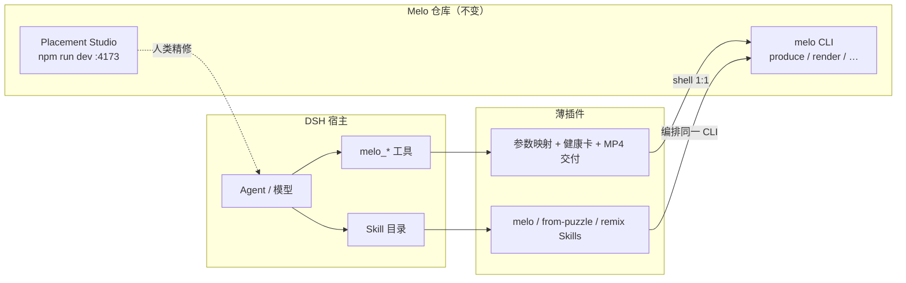

# DeepSeek Harness（dsh）集成

Melo 在 dsh 中的角色是 **领域生产运行时（CLI）**；dsh 是 **宿主**；`@melo-game/dsh-plugin-melo` 是 **薄安装壳**：注册工具包装器 + 捆绑官方 Skill，不复制出片/玩法逻辑。



## 设计原则

- **无内嵌 LLM**：Melo 不提供模型；Agent 通过原子 CLI 或 dsh 工具调用生产链。
- **单一实现**：`produce`、`render`、`capabilities` 等仍只在 `src/cli` 实现；插件只 `spawn` 已有 `melo` 可执行文件。
- **不是 Cordis 重写**：没有把 Studio、Runtime 或渲染搬进 dsh 插件；也未做「一切皆插件」的核心迁移。

## 安装

在 dsh profile 中安装本仓库内的 bundle（开发链）或未来发布的 npm 包：

```bash
# 克隆 Melo 后，在 dsh 侧（示例 profile 名 web）：
dsh plugin --profile web add link:/path/to/melo-game-creative-studio/packages/dsh-plugin-melo

# 可选：对话内联播放 MP4（Melo 不内置播放器，只正确交付路径）
dsh plugin --profile web add @orderg-x/dsh-video-preview
```

安装后 **重启 dsh**。在 Melo 仓库执行 `npm run build:cli`，并设置：

```bash
export MELO_CLI_PATH=/path/to/melo-game-creative-studio/dist-cli/cli/melo.js
```

## 工具面（与 CLI 1:1）

| dsh 工具 | CLI |
|---|---|
| `melo_health` | 组合探测 + `melo capabilities` |
| `melo_capabilities` | `melo capabilities` |
| `melo_produce` | `melo produce`（含零决策默认） |
| `melo_render` | `melo render` |
| `melo_studio` | 打印 `http://127.0.0.1:4173` 与 `npm run dev` 说明 |

成功生成 MP4 时，工具结果包含 **绝对路径** 与 **相对会话 cwd 的路径**，并通过宿主 `deliverables/presented` 通道递交文件（与官方 `present` / `@orderg-x/dsh-video-preview` 同款）。未安装 video-preview 时仍会得到文件芯片与路径。

## 零决策预览

对 `melo_produce` 不传业务参数时，默认：

- `block-placement` + `showcase` + `preview` 质量
- `max-moves` 5、`max-frames` 48
- `out-dir` = `<会话工作区>/melo-out/`

商业级长片、其他游戏或 cinematic 质量请显式传参，或使用第二份 Skill / 原子 CLI 分步执行。

## 官方 Skill

插件捆绑（与仓库 `skills/` 同源、路径已改为 dsh 工具表述）：

- `melo` — 入口索引
- `melo-from-puzzle-to-mp4` — 出题 → 试玩 → 工程 → 可选出片
- `melo-remix-looks` — 同 Take 多套皮

在 dsh 中通过 `skill` 工具加载名称即可。

## 期望管理

- CLI **preview** 出片用于 Agent 快速验收，**不等于** Placement Studio 商业 Golden 画质。
- 视觉终审与五条片单仍在 Studio；`melo_studio` 仅提示本地 URL，不替人类完成审片。

## 范围外

- 不在 dsh Web 内重写 Studio UI
- 不在插件内实现视频播放器（请用 peer `@orderg-x/dsh-video-preview`）
- 不改动 Mahjong 等非 CLI 游戏适配器

## 验收清单（六项）

详见 [`packages/dsh-plugin-melo/README.md`](../../packages/dsh-plugin-melo/README.md#ux-验收清单)（与插件 README 同步）。
